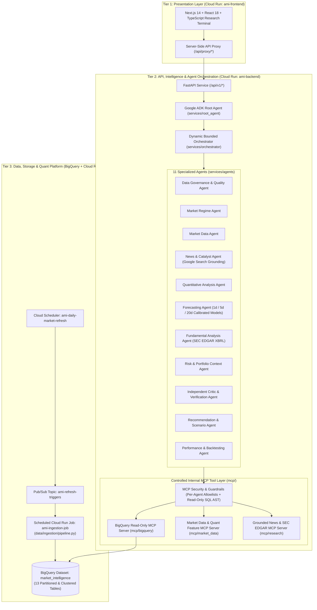

# Agentic Market Intelligence Platform (`agentic-market-intelligence`)

> **Institutional Decision-Support Research & Quantitative Intelligence Platform on Google Cloud**  
> Built with **Google Agent Development Kit (`google-adk`)**, **Vertex AI Gemini 2.5 (`GoogleSearch` Grounding)**, **Controlled Model Context Protocol (MCP) Servers**, **BigQuery Point-in-Time Feature Store**, **FastAPI**, and **Next.js 14 TypeScript**.

---

## 1. Executive Overview & Epistemic Policy

`agentic-market-intelligence` is a production-oriented, three-tier stock market intelligence and prediction platform deployed on Google Cloud (`qwiklabs-gcp-03-c81d344a3430`, `us-central1`). It combines point-in-time quantitative modeling, SEC EDGAR filings, FRED macroeconomic indicators, Google Search grounded catalyst discovery, and a hierarchical **13-agent system** (Root Agent + Dynamic Orchestrator + 11 Specialized Agents) to surface statistically defensible, risk-adjusted stock research scenarios.

### Mandatory Epistemic Classification
Every metric, narrative sentence, catalyst, and scenario produced by the platform is explicitly tagged with one of four epistemic labels:
- `[FACT]` — **Measured Historical Fact**: Observed market prices, realized returns, SEC EDGAR XBRL reported figures, or FRED macroeconomic releases with verified timestamps and source provenance.
- `[FORECAST]` — **Model-Generated Forecast**: Calibrated probabilistic outputs (`1d`, `5d`, `20d` horizons) from versioned quantitative walk-forward models with explicit uncertainty intervals and Brier calibration scores.
- `[INTERPRETATION]` — **Agent Interpretation**: Structured synthesis generated by specialized AI agents grounded in cited `[FACT]` and `[FORECAST]` inputs.
- `[HYPOTHESIS]` — **Unverified Hypothesis**: Conditional scenarios, unconfirmed catalysts, or low-coverage claims requiring independent verification.

> **Disclaimer**: This platform is an institutional decision-support and quantitative research system. It does **not** guarantee market returns, predict market movements with certainty, or provide personalized investment advice.

---

## 2. Three-Tier Architecture



---

## 3. Repository Structure

```text
agentic-market-intelligence/
├── apps/
│   └── frontend/                  # Tier 1: Next.js 14 + TypeScript Financial Research Terminal
│       ├── Dockerfile             # Multi-stage Node 20 Alpine standalone container build
│       ├── src/pages/index.tsx    # 6-tab dense institutional research terminal UI
│       ├── src/pages/api/proxy/   # Server-side proxy to Tier 2 FastAPI service
│       ├── src/styles/terminal.css# High-contrast dark institutional theme
│       └── src/types/market.ts    # Strict TypeScript interfaces matching Pydantic schemas
├── services/
│   ├── api/main.py                # Tier 2: FastAPI REST endpoints & OpenAPI documentation
│   ├── root_agent/agent.py        # Google ADK Root Agent & Intent Classifier
│   ├── orchestrator/engine.py     # Dynamic Bounded DAG Orchestrator & Parallel Executor
│   └── agents/                    # 11 Independently Testable Specialized Agents
├── mcp/
│   ├── security.py                # Per-agent tool allowlists, SQL AST guard, prompt sanitizer
│   ├── bigquery/server.py         # Controlled read-only BigQuery MCP server
│   ├── market_data/server.py      # Market data & point-in-time feature MCP server
│   └── research/server.py         # Vertex AI Gemini Google Search grounding + SEC EDGAR MCP
├── orchestration/
│   └── schemas/contracts.py       # Pydantic v2 typed inter-agent contracts & epistemic tags
├── data/
│   ├── ingestion/pipeline.py      # Tier 3: End-to-end OHLCV, SEC EDGAR, FRED & BQ loader
│   ├── features/engineer.py       # Point-in-time feature store (strict anti-leakage gate)
│   └── quality/validators.py      # Data completeness, staleness & anomaly checks
├── models/
│   ├── training/trainer.py        # Walk-forward regularized gradient/logistic + Platt calibration
│   ├── backtesting/engine.py      # Net-of-cost (10 bps cost + 5 bps slippage) walk-forward backtester
│   └── evaluation/metrics.py      # Brier score, calibration error, IC & drawdown analytics
├── infrastructure/
│   └── terraform/                 # Terraform IaC for Cloud Run, BigQuery, IAM, Pub/Sub, Scheduler
├── tests/
│   ├── unit/                      # Quant math, anti-leakage & schema contract unit tests
│   ├── security/                  # MCP allowlist, SQL injection & prompt-injection security tests
│   ├── integration/               # 11-agent DAG & Critic veto integration tests
│   └── end_to_end/                # Full FastAPI HTTP workflow tests
├── docs/                          # Architecture, BigQuery dictionary, Security & Runbooks
├── Dockerfile.backend             # Non-root Python 3.12 container for Tier 2 API & Ingestion Job
├── Makefile                       # Standardized developer & deployment commands
└── requirements.txt               # Pinned Python dependencies
```

---

## 4. Quick Start & Local Development

### Prerequisites
- Python `3.12+`
- Node.js `20+` and `npm`
- Google Cloud SDK (`gcloud`) authenticated to `qwiklabs-gcp-03-c81d344a3430`

### 1. Set Up Python Virtual Environment & Run Pipeline
```bash
python3 -m venv .venv
source .venv/bin/activate
pip install -r requirements.txt

# Run the full point-in-time data ingestion, feature engineering, model training, and BigQuery load
PYTHONPATH=. python3 data/ingestion/pipeline.py --mode full
```

### 2. Run Automated Test Suite (Unit, Security, Integration, E2E)
```bash
PYTHONPATH=. python3 -m unittest discover -s tests -p "test_*.py" -v
```

### 3. Start Tier 2 Backend API Locally (`http://localhost:8080`)
```bash
PYTHONPATH=. uvicorn services.api.main:app --host 0.0.0.0 --port 8080 --reload
```

### 4. Start Tier 1 Frontend Terminal Locally (`http://localhost:3000`)
```bash
cd apps/frontend
npm install
BACKEND_INTERNAL_URL=http://127.0.0.1:8080 npm run dev
```

---

## 5. Documentation Index

- [Architecture, Agent Hierarchy & Quantitative Methodology](docs/architecture/overview.md)
- [BigQuery Dataset & 13-Table Data Dictionary](docs/data_dictionary/bigquery_schema.md)
- [IAM Least-Privilege Model, MCP Security & Guardrails](docs/security/iam_and_guardrails.md)
- [Cloud Run Deployment, CI/CD, Monitoring & Teardown Runbook](docs/runbooks/deployment_and_operations.md)
