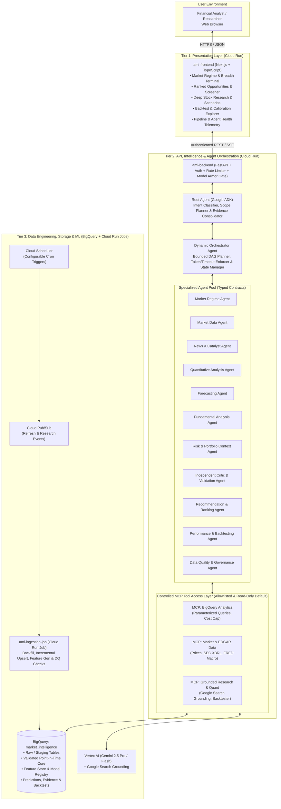
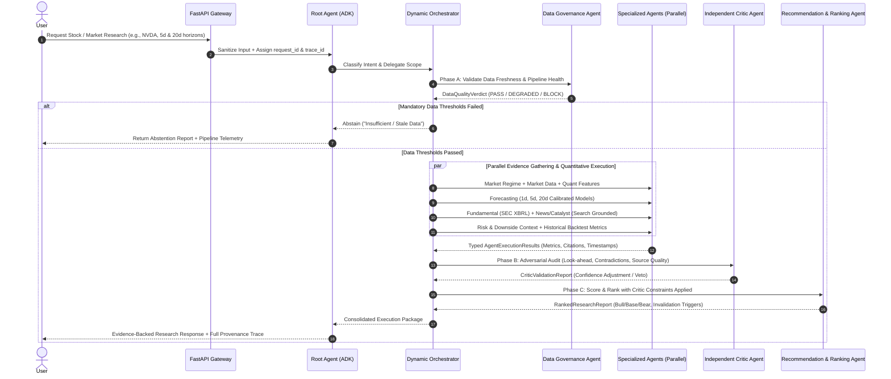

# Phase 1: Environment Discovery, System Architecture & Implementation Plan

> [!IMPORTANT]
> **Purpose & Scope Guardrail**: This platform is an evidence-backed quantitative research and decision-support workbench. It distinguishes measured historical facts, calibrated statistical model forecasts, agent interpretations, and unverified hypotheses. It does **not** guarantee returns, claim certainty, or execute autonomous brokerage trades.

---

## 1. Verified Environment & Integration Discovery

Before proposing or provisioning any infrastructure, a read-only inspection of the local machine, Google Cloud credentials, active project resources, and GitHub authentication was executed.

### 1.1 Google Cloud Platform Status

| Dimension | Verified Value | Status / Notes |
| :--- | :--- | :--- |
| **Active GCP Project ID** | `qwiklabs-gcp-03-c81d344a3430` | Project Number: `657944230490` (`ACTIVE`) |
| **Authenticated Identity (ADC)** | `student-01-762cf8004626@qwiklabs.net` | Active via `~/.config/gcloud/application_default_credentials.json` |
| **Billing Status** | `billingEnabled: true` | Linked to `billingAccounts/012761-0D2F3D-499DCA` |
| **Primary Region** | `us-central1` | Configurable via `GCP_REGION` / Terraform variables |
| **Verified IAM Permissions** | 18 / 18 tested permissions granted | Includes `bigquery.*`, `run.*`, `aiplatform.*`, `iam.serviceAccounts.*`, `secretmanager.*`, `artifactregistry.*`, `pubsub.*`, `cloudscheduler.*`, `serviceusage.*`, `resourcemanager.projects.setIamPolicy` |
| **Enabled Core APIs** | Vertex AI (`aiplatform`), BigQuery (`bigquery`, `bigquerystorage`), Cloud Run (`run`), Cloud Build (`cloudbuild`), Artifact Registry (`artifactregistry`), Secret Manager (`secretmanager`), Pub/Sub (`pubsub`), Cloud Tasks (`cloudtasks`), Logging, Monitoring, Cloud Trace (`cloudtrace`), Model Armor (`modelarmor`) | All enabled and verified |
| **APIs Pending Enablement** | `cloudscheduler.googleapis.com` | Currently disabled; requires explicit approval to enable for cron triggers |

### 1.2 Existing GCP Workloads (Isolation & Non-Disruption Inventory)

The project `qwiklabs-gcp-03-c81d344a3430` currently hosts an active workload from another project that **must not be modified or disrupted**:

- **Cloud Run Service (`us-central1`)**: `bronx-mobile-care-broker`
- **Cloud SQL Instance (`us-central1`)**: `public-health-db`
- **BigQuery Datasets**: `a4i_health` (24 tables/views) and `a4i_health_audit` (3 tables/views)
- **Secret Manager Secrets**: `CloudSQLSecret`, `GoogleMapsApiKey`
- **Artifact Registry (`us-central1`)**: `cloud-run-source-deploy`
- **Service Accounts**: `antigravity-sa@qwiklabs-gcp-03-c81d344a3430.iam.gserviceaccount.com`, default compute SA

> [!NOTE]
> **Strict Isolation Policy**: All resources for this platform will be strictly namespaced under prefix `ami-` (for services, jobs, service accounts, secrets, and Artifact Registry) and dataset `market_intelligence` in BigQuery. No existing resources will be altered or overwritten.

### 1.3 GitHub & Local Tooling Status

| Tool / Integration | Verified Status | Action Plan |
| :--- | :--- | :--- |
| **GitHub Authentication** | Authenticated as **`rishysingh`** via `git credential-osxkeychain` (`repo` scope verified via `GET https://api.github.com/user`) | Ready to create dedicated repo `rishysingh/agentic-market-intelligence` |
| **Target Repository** | `https://github.com/rishysingh/agentic-market-intelligence` | Verified **does not exist yet** (`404`); safe to create cleanly |
| **Python Runtime** | Python `3.14.6` (`/usr/local/bin/python3`) & `3.15.2` (`/opt/homebrew/bin/python3`) | Verified working with `google-adk 2.13.0`, `google-genai 2.33.0`, `google-cloud-bigquery 3.46.2`, `fastapi`, `pydantic` |
| **Google Cloud SDK** | `gcloud` / `bq` / `gsutil` `v577.0.0` at `/Users/rishysingh/google-cloud-sdk/bin/` | Installed; ADC credentials active |
| **Homebrew** | `/opt/homebrew/bin/brew` installed | Available to install `node` (for Next.js/React TypeScript frontend) and `terraform` (for IaC validation) |
| **Node.js / Terraform / Docker** | Not currently installed in `/opt/homebrew/bin` | Install `node` and `terraform` locally via Homebrew; use Cloud Build (`gcloud builds submit`) for reproducible container builds |

---

## 2. Three-Tier System & Hierarchical Agent Architecture

### 2.1 System Context & Three-Tier Architecture Diagram

### 2.2 Hierarchical Agent Execution & Validation Flow

Every research request traverses mandatory **Data Governance** and **Independent Critic** gates before any ranking or scenario is surfaced to the user:

### 2.3 Common Typed Agent Execution Contract

All agents implement a strict Pydantic v2 schema (`AgentExecutionEnvelope`) enforcing separation between deterministic calculation and LLM synthesis:

- `request_id`, `execution_id`, `parent_execution_id`, `trace_id`
- `agent_name`, `agent_version`, `model_id` (or `"deterministic-python"` for math/quant modules)
- `status`: `COMPLETED` | `PARTIAL` | `ABSTAINED` | `FAILED`
- `as_of_utc`, `input_dataset_versions`, `feature_set_version`
- `findings`: Agent-specific strongly typed payload
- `citations`: List of `SourceCitation(source_type, url, title, event_timestamp, publication_timestamp, retrieval_timestamp, reliability_tier)`
- `uncertainty`: `UncertaintyEstimate(metric_type, value, lower_bound, upper_bound, calibration_method, sample_size, abstention_reason)` — explicitly distinguishing **calibrated statistical probability** (from walk-forward empirical models) from **evidence completeness score**
- `validation_warnings`, `assumptions`, `limitations`
- `telemetry`: `ExecutionTelemetry(duration_ms, prompt_tokens, completion_tokens, tool_calls_count, retries, estimated_cost_usd)`

---

## 3. Data Platform, Source Evaluation & BigQuery Design

### 3.1 Market Data & Intelligence Source Evaluation

| Source Category | Primary Implementation | Licensing & Rate Limits | Coverage & Latency | Role in Platform |
| :--- | :--- | :--- | :--- | :--- |
| **Corporate Filings & Fundamentals** | **SEC EDGAR API** (`data.sec.gov/submissions` & `api/xbrl/companyfacts`) | Public domain (US Gov); requires `User-Agent` header; $\le 10$ req/sec | Full US public equities by CIK; exact `acceptanceDateTime` down to the second | Authoritative point-in-time fundamentals (Revenue, EPS, Cash, Debt, Shares) & 8-K/10-Q/10-K filing catalysts |
| **Daily OHLCV & Market Regime Prices** | **Multi-Provider Adapter**: Default zero-key EOD adapter (**Stooq / Yahoo Finance v8 Chart API**) + plug-and-play licensed adapters (**Polygon.io**, **Alpha Vantage**, **Tiingo**) via Secret Manager | Free EOD feeds are for research/demo only and labeled **Delayed / EOD**; commercial API keys unlock licensed redistribution | Daily OHLCV, split/dividend adjustments, S&P 500 core liquid universe + sector ETFs (`SPY`, `QQQ`, `IWM`, `XLK`, `XLF`, `XLE`, `XLV`, etc.) | Historical backfill, daily incremental refresh, technical indicators, volatility, and regime classification |
| **Macroeconomic Indicators** | **FRED / U.S. Treasury Public Feeds** | Public domain / open research | Daily Treasury yields (10Y, 2Y, 3M), credit spreads, VIX, CPI/unemployment series | Market Regime Agent inputs & macro risk sensitivity |
| **Financial News & Event Catalysts** | **Vertex AI Gemini Google Search Grounding** + **SEC 8-K Feed** | Covered under GCP Vertex AI terms | Real-time web search grounding with mandatory source URLs and publication timestamps | News & Catalyst Research Agent and Independent Critic disconfirming evidence search |

### 3.2 BigQuery Dataset (`market_intelligence`) Schema Architecture

All tables are housed in dataset `qwiklabs-gcp-03-c81d344a3430.market_intelligence` (`us-central1`) with explicit partitioning and clustering to control query costs:

1. `dim_security_master`: `security_id` (UUID/permid), `cik`, `ticker`, `company_name`, `exchange`, `sector`, `industry`, `is_active`, `effective_from`, `effective_to` (handles ticker changes and delistings).
2. `raw_daily_ohlcv`: Partitioned by `trade_date` (`DATE`), clustered by `security_id`, `ticker`. Includes `open`, `high`, `low`, `close`, `adj_close`, `volume`, `split_factor`, `dividend_amount`, `source_provider`, `source_timestamp`, `ingested_at`.
3. `stg_corporate_actions`: Splits, dividends, ticker renames, delisting events with `ex_date` and `recorded_at`.
4. `fact_fundamentals_pit`: **Strictly Point-in-Time** SEC XBRL observations. Partitioned by `filing_date`, clustered by `security_id`, `metric_name`. Tracks both `period_end_date` and exact SEC `acceptance_timestamp` (preventing look-ahead bias where Q3 earnings are mistakenly used on Sept 30 instead of the Nov 2 filing date).
5. `fact_macro_indicators`: Partitioned by `observation_date`, clustered by `series_id` (`DGS10`, `DGS2`, `T10Y2Y`, `VIXCLS`, etc.) with `release_timestamp`.
6. `fact_catalyst_events`: Partitioned by `event_date`, clustered by `security_id`, `catalyst_type`. Stores both `event_timestamp` and `publication_timestamp`, source URL, sentiment/direction, and deduplication hash.
7. `mart_quant_features`: Partitioned by `trade_date`, clustered by `security_id`, `feature_version`. Precomputed point-in-time features: `ret_1d`, `ret_5d`, `ret_20d`, `ret_60d`, realized volatility (`vol_20d`, `vol_60d`), ATR, RSI-14, MACD, Bollinger z-score, volume z-score (`vol_anomaly_20d`), beta to `SPY`, sector relative strength, and rolling max drawdown.
8. `model_registry`: Versioned model metadata (`model_id`, `model_version`, `target_definition`, `horizon_days`, `train_start_date`, `train_end_date`, `calibration_method`, `brier_score`, `roc_auc`, `precision_at_k`, `status`).
9. `fact_model_predictions`: Partitioned by `prediction_date`, clustered by `security_id`, `horizon_days`, `model_version`. Stores `target_threshold_pct`, `calibrated_prob_up`, `calibrated_prob_down`, `expected_return_bps`, `prediction_interval_low`, `prediction_interval_high`, `abstained`, `abstention_reason`.
10. `fact_recommendations`: Partitioned by `generated_date`, clustered by `security_id`. Stores composite ranking score breakdown, bull/base/bear scenarios, critic validation verdict, invalidation conditions, and citations JSON.
11. `fact_backtest_runs`: Walk-forward out-of-sample evaluation metrics (Sharpe, Sortino, Max Drawdown, Hit Rate, Calibration Curve buckets, turnover, net of 10 bps transaction cost + 5 bps slippage assumptions) vs. `SPY` benchmark.
12. `ops_pipeline_runs` & `ops_agent_traces`: Operational audit log tracking ingestion jobs, row counts, data freshness SLA status, agent execution traces, token consumption, and failure alerts.

### 3.3 Quantitative Targets & Anti-Look-Ahead Guardrails

- **Explicit Horizon & Threshold Targets**:
  - **1-Trading-Day (`1d`) Material Move**: Probability that forward 1-day excess return over `SPY` exceeds $+2.0\%$ (bullish tail) or falls below $-2.0\%$ (bearish tail), where threshold adapts to $\max(2.0\%, 1.5 \times \sigma_{1\text{d}})$.
  - **5-Trading-Day (`5d`) Swing Move**: Probability that forward 5-day excess return exceeds $+4.0\%$ (or $\le -4.0\%$).
  - **20-Trading-Day (`20d`) Tactical Trend**: Probability that forward 20-day excess return exceeds $+8.0\%$ (or $\le -8.0\%$).
- **Baseline Models & Calibration**:
  - Ridge / L2-regularized Logistic Regression + HistGradientBoostingClassifier (`scikit-learn`) with isotonic / sigmoid Platt scaling calibration on a strictly chronological validation fold.
  - **Abstention Gate**: Any model with out-of-sample Brier skill score $\le 0$ or ROC-AUC $< 0.52$, or any stock missing $>5\%$ of trailing 60-day bars or failing freshness SLAs, automatically triggers `status = ABSTAINED` ("Insufficient statistical evidence").

---

## 4. Proposed GCP Resource Plan, Permissions & Cost Drivers

### 4.1 Proposed Resource Inventory (`qwiklabs-gcp-03-c81d344a3430`)

| Resource Type | Proposed Name | Region / Location | Purpose | Cost Profile |
| :--- | :--- | :--- | :--- | :--- |
| **BigQuery Dataset** | `market_intelligence` | `us-central1` | 12 analytical, feature, prediction, and ops tables | Free tier covers first 10 GB storage & 1 TB/mo queries; expected $<\$1$/mo |
| **Artifact Registry** | `ami-repo` | `us-central1` | Docker container images for frontend, backend, and ingestion worker | $\sim\$0.10$/GB-month |
| **Service Accounts (4)** | `ami-frontend-sa` `ami-backend-sa` `ami-ingestion-sa` `ami-scheduler-sa` | Global | Least-privilege identity isolation per tier | \$0 (Free) |
| **Cloud Run Service (Tier 1)** | `ami-frontend` | `us-central1` | Next.js TypeScript Financial Research Terminal (`min_instances=0`, `max_instances=3`, `512Mi` RAM) | Scale-to-zero when idle; billed only per active request-second |
| **Cloud Run Service (Tier 2)** | `ami-backend` | `us-central1` | FastAPI + Google ADK Agent Orchestrator + MCP Servers (`min_instances=0`, `max_instances=4`, `1Gi` RAM) | Scale-to-zero when idle; billed per request-second |
| **Cloud Run Job (Tier 3)** | `ami-ingestion-job` | `us-central1` | Scheduled & on-demand market data ingestion, feature calculation, model scoring, and DQ validation | Runs for $\sim 1\text{--}3$ mins per trigger; $<\$0.05$/month |
| **Cloud Pub/Sub Topic** | `ami-refresh-triggers` | Global | Asynchronous event decoupling for data refresh & batch research jobs | Pennies per million messages |
| **Cloud Scheduler Job** | `ami-daily-market-refresh` | `us-central1` | Triggers `ami-ingestion-job` post-market close (`21:30 UTC` Mon–Fri) | \$0.10/job/month (first 3 free) |
| **Secret Manager Secrets** | `ami-api-auth-token` `ami-market-data-key` (optional) | Global | Backend API bearer/key secret & optional commercial market provider key | \$0.06 per active secret version/month |
| **Cloud Monitoring Alerts** | `ami-pipeline-failure-alert` | Global | Log-based metric alert on ingestion failures or stale data | Free tier |

### 4.2 Least-Privilege IAM Design

- `ami-frontend-sa`: `roles/run.invoker` on `ami-backend` only. Zero BigQuery or Vertex AI permissions.
- `ami-backend-sa`: `roles/bigquery.jobUser` (project), `roles/bigquery.dataViewer` on `market_intelligence` tables, `roles/bigquery.dataEditor` restricted to operational trace/recommendation tables (`ops_agent_traces`, `fact_recommendations`), `roles/aiplatform.user` (Vertex AI Gemini & Search Grounding), `roles/secretmanager.secretAccessor` on `ami-*` secrets only. **Cannot modify IAM, create infrastructure, or access `a4i_health` datasets.**
- `ami-ingestion-sa`: `roles/bigquery.dataEditor` on `market_intelligence` dataset, `roles/bigquery.jobUser`, `roles/secretmanager.secretAccessor` on `ami-market-data-key`.
- `ami-scheduler-sa`: `roles/run.invoker` on `ami-ingestion-job` and `roles/pubsub.publisher` on `ami-refresh-triggers`.

### 4.3 Technical & Operational Risk Register

| Risk ID | Risk Description | Likelihood | Impact | Mitigation Strategy |
| :--- | :--- | :---: | :---: | :--- |
| **R-01** | **Look-Ahead Leakage in Backtesting** (using fundamentals or restated prices before their actual publication timestamp) | Medium | High | Store both `period_end_date` and SEC `acceptance_timestamp` in `fact_fundamentals_pit`; enforce `acceptance_timestamp <= as_of_timestamp` in all feature queries and unit tests. |
| **R-02** | **Unverified LLM Hallucinations or Subjective Probabilities** | Medium | High | Forecasting probabilities come exclusively from versioned Python statistical models (`scikit-learn`). LLMs cannot overwrite numeric probabilities; Critic Agent cross-checks every cited metric against MCP tool outputs. |
| **R-03** | **Prompt Injection via External News / Web Content** | Medium | High | Wrap external search snippets in untrusted XML delimiters, sanitize control tokens, apply Model Armor / regex injection filters, and restrict agents to read-only parameterized MCP tools. |
| **R-04** | **Free Market Data Rate Limits or Stale Feeds** | Medium | Medium | Implement exponential backoff, local/BQ caching, multi-provider fallback (Stooq + Yahoo Finance + SEC EDGAR + deterministic synthetic/cached fallback clearly badged if offline), and strict Data Governance staleness gates. |
| **R-05** | **Cloud Cost Spikes from Runaway Agent Loops or BigQuery Scans** | Low | High | Enforce Orchestrator hard caps (`max_parallel_agents=6`, `max_retries=2`, `request_timeout=60s`, `max_token_budget=32000`), BigQuery `maximum_bytes_billed = 100 MB` per query in MCP, and Cloud Run `max_instances` caps. |

---

## 5. Phased Implementation & Deployment Sequence

1. **Phase 1 — Discovery & Design (Current)**: Complete environment discovery, architecture blueprint, and obtain approval for repo creation, tool installation, and GCP resource provisioning.
2. **Phase 2 — Repository & Foundation**: Create local workspace `/Users/rishysingh/.gemini/antigravity/scratch/agentic-market-intelligence` and dedicated GitHub repository `rishysingh/agentic-market-intelligence`. Set up monorepo layout, `.gitignore`, `.env.example`, `Makefile`, Terraform modules (`infrastructure/terraform/`), and GitHub Actions CI/CD workflows (`.github/workflows/`).
3. **Phase 3 — Data Platform & BigQuery**: Provision `market_intelligence` dataset and all 12 tables in BigQuery. Implement SEC EDGAR, daily OHLCV, and FRED macro ingestion pipelines (`data/ingestion/`), historical backfill for a core liquid US equity universe (e.g., 30 major S&P 500 stocks across all 11 GICS sectors + benchmark ETFs `SPY`, `QQQ`, `IWM`, `TLT`, `GLD`), point-in-time feature transformations (`data/features/`), and data quality gates (`data/quality/`).
4. **Phase 4 — MCP Tool Layer & Hierarchical Agent System**: Implement the 3 MCP servers/modules (`mcp/bigquery`, `mcp/market_data`, `mcp/research`), the typed execution contract, the **Root Agent**, the **Dynamic Orchestrator**, and all **10 Specialized Agents** using `google-adk` and Vertex AI Gemini (`gemini-2.5-pro` / `gemini-2.5-flash`) with Google Search grounding.
5. **Phase 5 — Quantitative Intelligence & Backtesting**: Implement chronological walk-forward training (`models/training/`), probability calibration (`models/evaluation/`), transaction-cost-aware backtesting (`models/backtesting/`), and populate BigQuery with verified out-of-sample predictions, calibration metrics, and ranked watchlists.
6. **Phase 6 — Frontend Terminal & API Integration**: Build the Next.js + TypeScript Financial Research Terminal (`apps/frontend/`) and FastAPI backend (`services/api/`), connecting real BigQuery data, live agent research workflows, interactive price/indicator charts, bull/base/bear scenarios, citations, and pipeline health telemetry.
7. **Phase 7 — Automated Testing, Security Verification & Cloud Run Deployment**: Run unit, integration, security, and end-to-end tests (`tests/`). Deploy `ami-backend`, `ami-frontend`, and `ami-ingestion-job` to Cloud Run (`us-central1`) and verify live endpoints.
8. **Phase 8 — Documentation & Handover**: Finalize architecture docs, data dictionary, security documentation, operational runbooks, and final status report.
